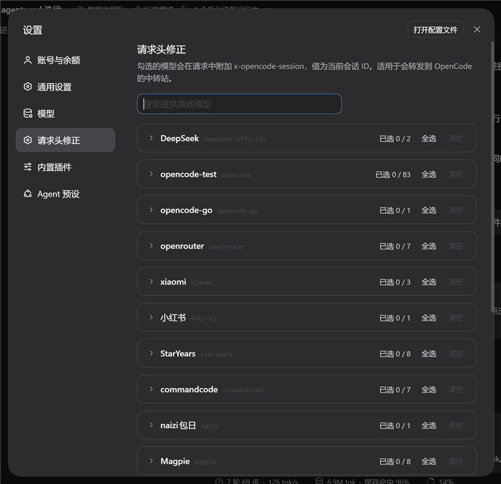
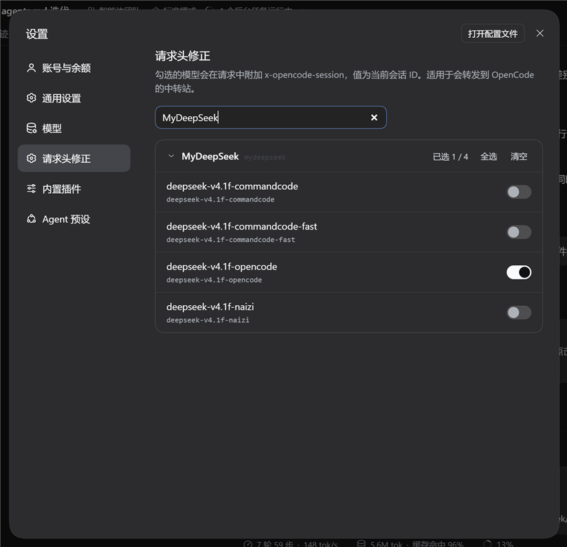

# dsh-request-header-fix

给 DSH（DeepSeek Harness）的设置弹窗加一个「请求头修正」分区：按 **provider → 模型** 两级勾选，被勾选的模型在发请求时会多带一个头

```text
x-opencode-session: <当前 DSH 会话 UUID>
```

装、卸都只改 profile（依赖 + profile 的 bundles 列表 + 本包 patch 提供的 Loader 行），不动 DSH 安装目录。默认全关，安装后不改变任何请求。

## 安全性（先读）

- **不碰会话存储和 DSH 安装目录。** 插件不读写会话文件、数据库或会话结构；会话 UUID 只从 `llm/stream` 的 `sessionId` 读出来，放在 host 进程内存里的 AsyncLocalStorage 上下文，用完即弃。不写 DSH 安装目录，安装与回退只改 profile。
- **唯一的持久化写入是本插件自己的设置项。** 勾选状态通过 DSH 自己的设置服务写进本插件的命名空间（profile 的 `cordis.patch.yml` 里 `headerFix`）；清空勾选就是 `unset`。
- **请求仍由原 `fetch` 执行。** 插件只在 host 进程的 `globalThis.fetch` 外包一层：命中才加一个 `x-opencode-session` 头，其余原样转发；卸载或进程退出即恢复，恢复前会确认补丁仍属于自己。
- **没有自己的网络行为。** `src/` 里没有独立的 `fetch`、文件读写或浏览器存储调用；唯一的网络请求是本来就要发的模型请求。不发布 npm、不注册服务、不打开端口。
- **默认全关。** 安装后不勾任何模型时，请求与原来完全一样；设置 → 插件里也不会出现本插件自动生成的配置表单（`auto: false`）。

代价与关闭方式：勾选之后，你选中的 provider 和它背后的中转站会收到**当前会话的 UUID**——这是功能本身，不是副作用。已经发出去的请求收不回来；想让后续请求立刻不带，清空全部勾选（下一条请求生效），或卸载插件后重启 `dsh web`。

未验证的残留：卸载不一定会清理 profile 里已经写下的 `headerFix` 设置项（那是设置数据，不是包文件）；要彻底干净，卸载前先清空全部勾选。

## 截图

设置弹窗左侧导航多一项「请求头修正」，order 12，排在「模型」（10）与「插件」（15）之间。





截图取自 2026-11-02 本机运行的 `dsh web`（真实 provider 与勾选状态）；第二张是搜索过滤到单个 provider 后展开的样子。真机验收状态见「验证状态」。

## 目的与代价

有些中转站（例如转发到 OpenCode 的线路）要求请求里带 `x-opencode-session` 才能把会话串起来。DSH 内置只对 `opencode` / `opencode-go` 这类 provider 自己补这个头，其它 provider 不会。这个插件就是给「你自己配置的 provider」补上同一个头。

代价、默认值与关闭方式集中在「安全性（先读）」，这里不再重复。

## 页面在哪

页面是 provider → 模型 两级：每个 provider 一张分组卡片，组头是显示名、provider id 和「已选 n / m」，组内每个模型一行，右侧一个开关；模型名为主、模型 id 为辅。

分组默认收起，只显示提供商行；点提供商行（组头）展开或收起该组模型，避免模型多的线路把页面拉得很长。搜索时命中的分组自动展开。

只列「已添加 / 已配置」的 provider，`deepseek-account` 不列（账号路由不走这套配置）。

顶部有搜索框，按 provider 名 / id、模型名 / id 过滤当前列表。

组头有「全选」「清空」两个文字按钮；该组没有可用模型时两个按钮禁用。provider 在模型目录里加载失败时，组内显示失败原因；目录里没有这个组也没有失败时，显示「当前没有可用模型」。

页面状态：加载中有占位；没有任何已配置 provider 时显示「还没有已添加的模型提供商。」；搜索无结果时显示「没有匹配的提供商或模型。」；设置只读（`describe().writable === false`）时所有开关禁用并提示；找不到本插件的设置命名空间时显示「宿主半边未加载，请重启 dsh web」；加载失败给错误文案和重试按钮；单行写入失败时该行下显示错误，开关回滚到旧值。

## 开关写到哪里

开关存在插件自己的设置命名空间里（loader 行 id = `request-header-fix`；Loader 行由本包 `cordis.patch.yml` 提供，写入的配置落进 profile 的 `cordis.patch.yml` 并按这个 id 定位），字段是 `headerFix: Record<provider, string[]>`，数组元素是**模型 id**。

写入语义：

- 开一个模型 → 对该 provider 的键 `set` 加上这个 id 的数组（去重）；键不存在就新建。
- 关一个模型 → `set` 去掉这个 id 后的数组；数组空了就改成 `unset` 这个键，配置里不留空数组。
- 「全选」→ `set` 为该组当前全部模型 id；「清空」→ `unset` 这个 provider 的键。
- 每次写入带当前 `revision`；遇到 `settings/conflict` 就重新 `describe()` 拿新 revision 再写一次，仍失败显示错误。
- 写入期间该行（或该组）的交互禁用，避免并发写把冲突放大。

配置写进 profile 后大致是这样：

```yaml
- id: request-header-fix
  name: dsh-request-header-fix
  config:
    headerFix:
      mydeepseek:
        - deepseek-v4.1-flash
        - qwen3.8-max
```

## 安装

先在本仓库目录里装依赖、出产物（`link:` 直接指向这个工作副本，`lib/` 必须已经存在）：

```bash
npm install
npm run typecheck
npm run build
```

然后把目录交给插件管理器：

```bash
dsh plugin --profile web add link:<本仓库的绝对路径>
```

`link:` 指向的是这个工作副本（不是 npm 包名）。Windows 上路径写成 `link:C:/Users/<user>/Desktop/dsh-request-header-fix` 这种正斜杠形式。

装完检查 `%USERPROFILE%\.dsh\profiles\web\package.json`：`dsh.profile.bundles` 里应出现 `dsh-request-header-fix`。Loader 行（`- id: request-header-fix`）由本包自己的 `cordis.patch.yml` 提供，插件管理器把它当 profile 层加载，不需要你手改 profile 的 yml。

最后**重启 `dsh web`**。host 半边只在进程启动时加载，不重启看不到分区；重启这一步由你来执行。

## 卸载

```bash
dsh plugin --profile web remove dsh-request-header-fix
```

然后重启 `dsh web`。不重启的话，旧进程内存里的 host 半边和 fetch 补丁还在，请求可能继续带头。

不想卸载、只想让它闭嘴：把全部勾选清空即可，下一条请求就不带头。

## 环境

| 项 | 版本 |
|---|---|
| DSH | 0.2.2-alpha.2 |
| Node | v24.15.0 |
| npm | 11.14.1 |

以上为 2026-11-02 核对。本包自带构建链，不依赖 DSH 仓库：

```bash
npm install       # 只装本包依赖（运行时只有 schemastery；构建与类型检查用 esbuild、typescript、react 与 @types/*）
npm run typecheck # tsc --noEmit，只查 src/
npm run build     # esbuild 出 lib/index.js（host）与 lib/client.js（browser）
```

## 行为与边界

注入点在 `llm/stream` 瀑布下游的全局 `fetch`：监听器把 `{ sessionId, provider, model }` 带进 AsyncLocalStorage 上下文，fetch 补丁按当前的勾选决定加不加头。

| 条件 | 行为 |
|---|---|
| provider 已配置，`headerFix[provider]` 含本次请求的 `model`，且请求有 `sessionId` | 加 `x-opencode-session: <sessionId>` |
| provider 命中了，但该 model 没勾选 | 原样放行 |
| provider 不在开关表里，或数组为空 | 原样放行 |
| 没有 `sessionId`（少数旁路调用） | 原样放行 |
| 不在 `llm/stream` 上下文（模型发现、用量查询、web 工具） | 原样放行 |
| 请求里已有同名头（例如 profile 里写死的静态头） | 用会话 id 覆盖 |
| 加头过程抛异常 | 记 warn，退回原样发送 |

匹配口径是 `options.provider` 与 `options.model` 两个精确字符串：不做通配、不做前缀匹配。模型 id 改了就是没匹配上，不会误伤同 provider 的其它模型。

头的值来自 DSH 会话 UUID：同会话稳定、跨重启不变、不同会话不同。插件不生成、也不持久化自己的 id。会话压缩和标题生成用的是同一个会话 id；如果它们用的模型也被勾选，同样会带头。

开关是 volatile 字段，注入端每次请求实时读当前值，不在启动时拍快照。改完勾选，后续请求按新值走（实时生效的时序以真机验收为准，见文末）。

范围只针对 `web` profile；多个 profile 各有各的设置文档和命名空间，互不影响。

## 故障排查

**设置页不出现「请求头修正」**：确认 `dsh web` 已重启、profile `package.json` 的 `dsh.profile.bundles` 含本包、本包 patch 提供的 Loader 行没被禁用；再确认本包 `package.json` 的 `dsh.client.inject` 含 `@deepseek-ai/dsh-client-ui-settings`——座位由它提供，缺了注册会静默失效。

**分区排位不对**：本插件用 `order: 12`，靠的是「模型」= 10、「插件」= 15。宿主版本改了内置 order 就会变位，以宿主为准。

**提示「宿主半边未加载，请重启 dsh web」**：客户端在设置命名空间列表里找不到本插件。通常是 host 半边没加载（profile 的 `dsh.profile.bundles` 里没有本包，或 Loader 行被禁用）；先确认这两处，再重启。

**勾选后请求没变化 / 关掉后还带头**：先确认页面上的勾选确实落盘（看 `cordis.patch.yml` 里 `headerFix`），再确认发请求的 `dsh web` 进程是加载了本插件的那一个；host 半边改过要重启才生效。

**设置页提示冲突（settings/conflict）**：同一个设置文档被别处同时写了。页面会重新读一次 revision 再重试一次；还失败就再操作一次，检查是否有另一个标签页或插件在写同一份设置。

**模型 id 漂移**：上游改了目录 id、或 provider 配置被改过之后，配置里已保存的旧 id 会留在原处，但页面上不再显示；它不影响其它模型，也不会误匹配。重新勾选当前模型即可；旧的残留不会自动清理。

**重启后勾选没了**：确认配置确实写进了 profile 的 `cordis.patch.yml` 中 `- id: request-header-fix` 的 `config` 下。只写进运行内存、没落到 profile 的改动，重启就会丢。

**改了客户端重建了却没效果**：浏览器可能还挂着旧的 combo URL。宿主按产物文件的元数据（mtime / ctime / size）算 revision，拼进 client 模块 combo URL 的 `&rev=`；`dsh-client-hmr` 在产物重建后会把新 bundle 推给页面。如果页面仍表现旧行为，刷新页面（必要时禁用缓存再 reload），并确认 `lib/client.js` 里确实有新改动。

**卸载后还带头**：确认已重启 `dsh web`。旧进程里的 fetch 补丁只在进程退出时消失。

## 开发

`src/` 是唯一真源，`lib/` 只由 `npm run build` 生成，不手改。

`package.json` 的 `exports` 里 `./client` 必须指向 `lib/client.js`：DSH 的 client-modules 按这条导出找浏览器半边，找不到会在客户端模块注册时直接抛错（整个页面可能一起报错），不是只少一个分区。

`npm run build` 出两个产物：`lib/index.js`（host，node ESM）与 `lib/client.js`（browser，lazy-CJS 包装成 `window.__ModuleLoader__.load({ id, factory })`）。构建脚本自带接线自检，任何一项不过就以非零码退出：

- 客户端产物以 `window.__ModuleLoader__.load(` 开头，`id` 等于 `package.json` 的 `name`；
- 用 `new Function('window', 'require', code)` 模拟加载器，factory 返回的对象有 `apply` 函数、`inject` 数组、没有 `default`；
- factory 里 `require` 的模块名只能是基线模块：`react`、`react/jsx-runtime`、`@deepseek-ai/dsh-client-ui-primitives`；
- host 产物 `import()` 后 `apply` 是函数、`Config` 存在。

自检之外还做过一次负向验证（人工一次性，不在 build 里自动跑）：故意把包装时的 `id` 改成错误值，`npm run build` 必须失败；改回从 `package.json` 读 `name`，必须通过。

仓库没有自动化测试（单元、集成、UI 都没有）；`typecheck` 与 `build` 自检是唯一的机器门。视觉与行为验证在真实 GUI 里做。

## 验证状态

离线门的判据：`npm run typecheck` 通过，`npm run build` 自检全绿。负向验证是人工做过的一次性核对（改错 wrapper id 必须失败、改回必须通过），不是 build 的自动用例。

**真机验收由维护者执行**，以下各项在真实 `dsh web` 里确认前都算未验证：

1. 安装后重启，设置弹窗左侧出现「请求头修正」，位置在「模型」与「插件」之间，点开无报错。
2. 页面按 provider 分组列出已配置的 provider（例如 `mydeepseek`），组内模型与输入条模型卡一致；`deepseek-account` 不出现；默认全关。
3. 只勾选某 provider 下的模型 A：用 A 发消息，中转站日志出现 `x-opencode-session: <uuid>`，值等于该会话 id；同会话第二条不变；换会话变化。
4. 用同 provider 的模型 B（未勾选）发消息：没有该头。
5. 关掉模型 A：下一条请求不再带头；「全选」/「清空」行为正确。
6. 重启 `dsh web`：勾选状态保留。
7. 设置 → 插件：不出现本插件自动生成的配置表单。
8. 打开本页期间在别处改设置：页面不崩溃，冲突重试生效。
9. 勾选/取消的实时生效时序（volatile 读取）与 `auto: false` 的实际效果。

## 许可

MIT，全文见 [LICENSE](LICENSE)：可以随意使用、修改、再分发、商用，只需保留版权与许可声明；软件按「现状」提供，不附带担保。
